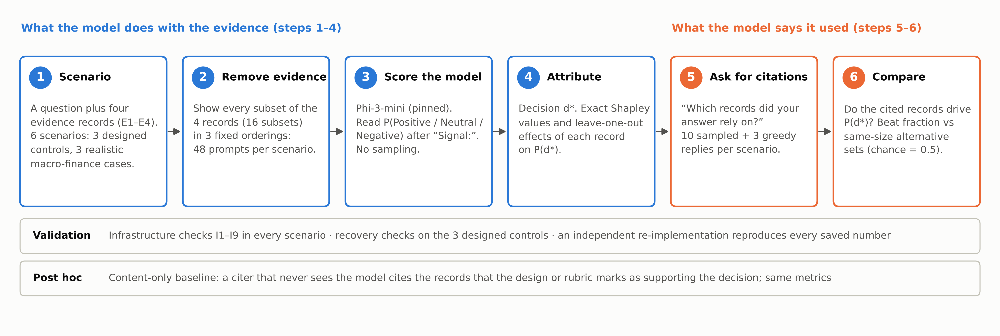
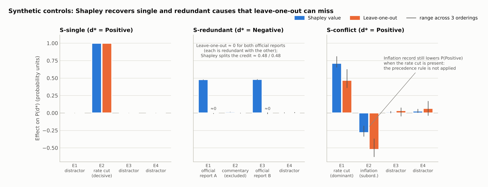
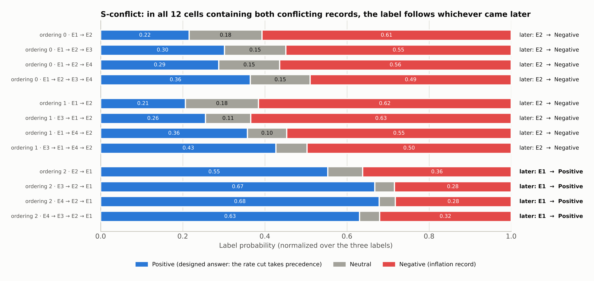
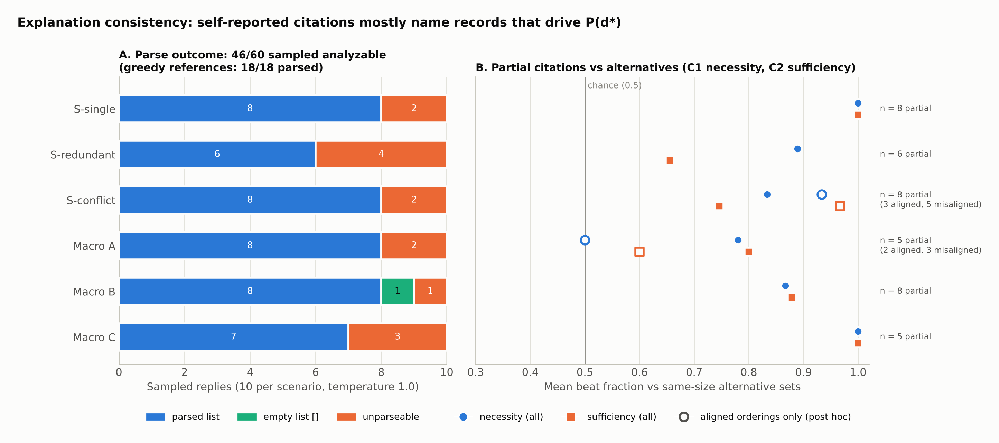
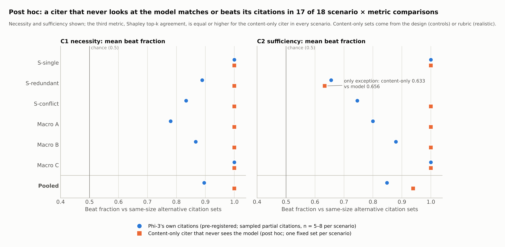

# Memory X-Ray

**Do an LLM's self-reported evidence citations match the evidence that actually drives its decisions?**

Memory X-Ray is an independent research project in explainable and responsible AI at Duke University: a small, fully
reproducible case study. A language model (Phi-3-mini) answers questions from four evidence records. We measure which
records actually move its answer by removing them, then ask the model which records it relied on and check whether the
two agree.

> **Scope in one line:** one model, one prompt template, **six scenarios**. All attributions are *behavioral*: they
> describe how the model's output changes when evidence is removed, not what happens inside the model. The results are
> case studies, not population estimates.



**Contents:** [Key findings](#key-findings) · [Quick start (no GPU)](#quick-start-no-gpu) ·
[Method](#method) · [Limitations](#limitations) · [Reproducing the experiment](#re-running-the-gpu-experiment-optional) ·
[Repository structure](#repository-structure) · [Documentation](#documentation) · [Citation and license](#citation-and-license)

---

## Research question and motivation

When a model answers from supplied evidence (retrieved documents, memory records, tool outputs) it is often asked to
cite its sources, and those citations are read as an explanation of the answer. A citation can be *plausible*, naming
records that support the answer, without being *faithful*, naming the records that actually drove the model's output.

This study asks: **how consistent are a model's self-reported evidence citations with the behavioral influence of that
evidence on its decision?** It tests the question under controlled conditions:
- designed scenarios with a known causal structure;
- an exact attribution over every subset of the evidence;
- pre-registered metrics, frozen before the full run.

### What this study can and cannot claim

| This study measures | It does **not** measure |
|---|---|
| **Behavioral attribution.** How the probability of the model's answer changes when evidence records are removed or kept (exact Shapley values, leave-one-out, necessity, sufficiency). | **Internal faithfulness.** Which computations inside the network produced the answer. No mechanistic or gradient-based analysis was done. |
| **Citation consistency.** Whether the records the model cites have larger behavioral effects than other sets of the same size. | Whether the model *introspects* correctly. Consistent citations are compatible with faithful self-report and with naming content that supports the shown label (see the post hoc baseline below). |

Related work that this study builds on and does not claim to supersede includes context attribution by ablation
(ContextCite; SelfCite), self-consistency tests of LLM self-explanations (Madsen et al., 2024; Parcalabescu & Frank,
2024), and the distinction between citation correctness and faithfulness (Wallat et al., 2025). Full references are in
[`poster_materials/REFERENCES.md`](poster_materials/REFERENCES.md).

## Key findings

Labels: **[pre-registered]** = defined before the run; **[post hoc]** = exploratory, defined after the data were seen.
Ranges are min–max over three fixed evidence orderings. They show sensitivity to order and are **not confidence
intervals**. The 288 scored prompts (6 scenarios × 16 subsets × 3 orderings) are structured, deterministic measurements,
**not 288 independent samples**: the unit of evidence is the scenario, and n = 6.

1. **The measurement is sound and reproducible.** [pre-registered]
   - Infrastructure checks I1–I9 pass in 6/6 scenarios.
   - An independent re-implementation reproduces every saved probability, Shapley value, check and citation score; the
     largest Shapley difference is 2.2 × 10⁻¹⁶.
   - The single-cause control (S-single) and the redundancy control (S-redundant) pass all their recovery checks.

2. **Shapley values reveal redundancy that leave-one-out misses.** [pre-registered]
   - In S-redundant, each of two official reports carries a Shapley value of about 0.48, but its leave-one-out effect is
     about 0, because the other report still settles the answer.
   - The same masking appears in realistic Macro C: the supporting records have Shapley values of 0.28–0.35 but
     leave-one-out effects of only 0.04–0.07.

3. **The conflict control fails: the model does not follow an instructed precedence rule.** [pre-registered checks;
   descriptive count]
   - S-conflict fails recovery checks BC1, BC3, BC4 and BC5 (BC5 marginally, for a separate reason: one distractor's
     Shapley value is 0.057 against a 0.05 limit).
   - In the 12 prompts that contain both conflicting records, the label follows whichever record appears **later** in
     all 12; the precedence rule holds in only 4.
   - This rests on a single ordering contrast (only one of the three fixed orderings puts the overriding record last),
     confounded with last position and adjacency. It is consistent with a recency effect but does not isolate one.
   - Attribution of conflict structure is therefore **not validated** by this run.

4. **Realistic scenarios: signs right, weights different, one fragile decision.** [rubric reference and rubric-following
   values fixed before the run; the comparison is descriptive]
   - The decision matches the rubric reference in 3/3 realistic scenarios, and the Shapley signs match the rubric for
     12/12 records.
   - In Macro A, the single contrary record carries about twice the rubric-following weight (Shapley −0.48 vs −0.25).
   - In Macro C, the salient rate cut is effectively ignored (−0.02).
   - Macro A's answer is Neutral in one ordering and Positive in two, and the decision rests on a mean margin of 0.020.

5. **Counterfactual flips move probabilities more than labels.** [post hoc, descriptive]
   - Reversing one record lowers the probability of the original decision in 9/9 cases (by 0.17 to 0.54), but changes
     the label in only 5/9.
   - The pre-registered label-based test C4 holds only for Macro A, and partly trivially.

6. **Self-reported citations mostly name high-influence records.** [pre-registered]
   - Partial citations beat same-size alternatives on necessity (mean 0.896; 37/40 above chance) and on sufficiency
     (0.848; 38/40). Chance is 0.5.
   - In the controls, the planted cause is cited in 8/8 (S-single) and 6/6 (S-redundant) parsed sampled replies, but in
     only 2/8 for S-conflict, where the model most often cites both conflicting records.
   - 14 of 60 sampled replies (23%) could not be parsed under the strict, frozen parser.

7. **Citation-stage decision mismatch.** [pre-registered metric; post hoc split]
   - The citation prompt shows the scenario-level decision d\*, which is averaged over orderings. In 3 of 18
     scenario-orderings, that was not the model's own answer for that ordering.
   - The model still cited records that push toward the label it was shown. All 8 partial citations from those
     orderings beat chance for the shown label, though they scored lower on average than in aligned orderings
     (0.85 / 0.73 vs 0.91 / 0.88).
   - In Macro A ordering 0 it named exactly the drivers of a label it had not chosen. In S-conflict, by contrast, these
     citations included the record that pushes against the shown label.
   - Citations here are best read as **label-conditional rationales**.
   - [post hoc] Rescoring those citations against the model's own decision lowers them from 0.84 / 0.71 to 0.65 / 0.41.
     This is not a valid fix, because it asks a question the model was not asked.

8. **A citer that never looks at the model does as well.** [post hoc]
   - A rule that cites the records whose *content* supports the answer, judged from the experimenter's design (controls)
     or rubric (realistic scenarios), scores 1.000 / 0.939 / 1.000 (necessity / sufficiency / Shapley top-k), against
     the model's 0.896 / 0.848 / 0.883. This is not a like-for-like comparison: one fixed set per scenario, against the
     model's sampled citations.
   - It matches or beats the model in 17 of 18 scenario × metric comparisons: higher in 10, tied in 7, lower in 1. The
     exception is S-redundant sufficiency, 0.633 vs 0.656.
   - So high citation-consistency scores here are **not evidence of faithful self-explanation**: these metrics cannot
     tell faithful self-report from citing content that supports the label. See
     [`docs/POST_HOC_ADDENDUM.md`](docs/POST_HOC_ADDENDUM.md).

**Bottom line.** Exact, subset-based behavioral attribution works as a measurement, and it catches redundancy that
leave-one-out misses. The model's self-citations look consistent with it. But that consistency is matched by a
behavior-blind citer, and it persists, somewhat weaker, when the model justifies a label that was not its own answer in
that ordering. In this design, citation
consistency shows that the model can name records that push toward a given label, not that it faithfully reports what
drove its own decision.

Every number above can be checked against [`poster_materials/KEY_NUMBERS.md`](poster_materials/KEY_NUMBERS.md), which
is generated from the result files. The full analysis is in
[`results/RESULTS_AND_DISCUSSION.md`](results/RESULTS_AND_DISCUSSION.md).

| | |
|---|---|
|  |  |
| Shapley vs leave-one-out in the designed controls | S-conflict: the later record decides |
|  |  |
| Citation consistency (pre-registered) | Content-only baseline (post hoc) |

## Quick start (no GPU)

Everything in the report can be reproduced on a laptop CPU from the saved run, in about a minute. You need no GPU, no
model download and no API key. Python ≥ 3.10 works; **Python ≥ 3.12 is recommended** (the run used 3.13).
Python 3.12 changed how `sum()` adds floating-point numbers, so on 3.10–3.11 recomputed values can differ from the
committed ones in the last digit (about 10⁻¹⁶). Every check, decision and reported number is unaffected.

```bash
git clone https://github.com/FarnooshMemari/memory-xray.git   # or unzip the release ZIP
cd memory-xray
python -m venv .venv && source .venv/bin/activate              # Windows: .venv\Scripts\activate
pip install -r requirements.txt                                # matplotlib, pytest, huggingface_hub (no model download)

python scripts/verify_release.py      # checksums, freeze, full reanalysis in a temp copy: expect "RELEASE VERIFIED"
python -m pytest -q                   # tests; the tiny-model tests that need PyTorch are skipped without it
```

Then explore:

| To do this | Run |
|---|---|
| Browse the results interactively | open [`notebooks/explore_results.ipynb`](notebooks/explore_results.ipynb) (already executed; re-run with Jupyter or Colab) |
| Recompute everything without touching any file | `python scripts/verify_release.py` (runs every analysis script in a temporary copy and compares) |
| Recompute everything with independent code | `python analysis_full/independent_reanalysis.py` → prints `INDEPENDENT REANALYSIS AGREES WITH PIPELINE: True` |
| Regenerate every number in the report | `python analysis_full/report_numbers.py` |
| Run the post hoc content-only baseline | `python analysis_full/content_only_baseline.py` |
| Recompute the pipeline's checks from the raw run files | `python reanalyze.py runs/full_20261017T223452Z` (writes to `outputs/`) |
| Redraw the figures (as new copies) | `python analysis_full/export_figures.py` (→ `results/figures/publication/`) and `python analysis_full/poster_figures.py` (→ `poster_materials/figures/`) |
| Regenerate the poster numbers | `python scripts/make_key_numbers.py` |
| Exercise the whole pipeline with a mock model | `python run_experiment.py --backend mock --out outputs/mock_runs` |

The three `analysis_full/` scripts and the figure scripts rewrite their outputs in place.
- **JSON files** (`results/`): with Python ≥ 3.12 on x86-64 they are rewritten byte-for-byte, so `git diff` stays
  empty. On 3.10–3.11, and on Apple Silicon, a few values differ in the last floating-point digit (at most about
  10⁻¹⁶); restore them with `git checkout results/`.
- **Figures:** byte-identical only with the same matplotlib and font stack (matplotlib 3.11.2 was used). The original
  script `analysis_full/make_figures.py` overwrites the original report figures in `results/figures/`, which are
  checksummed. Use `export_figures.py` for new copies, or restore with `git checkout results/figures/`.

`make help` lists the same commands as Make targets.

For the full test suite, including the tiny-model PyTorch tests, run `pip install -r requirements-dev.txt`.

## Method

| Component | Design |
|---|---|
| Model | `microsoft/Phi-3-mini-4k-instruct`, pinned to commit `f39ac1d28e925b323eae81227eaba4464caced4e`; float16 storage, float32 compute; Colab Tesla T4 |
| Scenarios | **3 designed controls** with the answer rule stated in the instruction: S-single (one decisive record), S-redundant (two records, each sufficient alone), S-conflict (two records with an instructed precedence). **3 realistic** de-identified macro-finance scenarios (Macro A–C), with reference answers from a written rubric that the model never sees |
| Evidence lattice | 4 records → all 16 subsets × 3 fixed orderings = **48 prompts per scenario**. Opaque record IDs (e.g. `[R7]`) are re-mapped in each ordering |
| Scoring | No sampling. P(` Positive` / ` Neutral` / ` Negative`) after the forced prefix `Signal:`, normalized over the three labels |
| Decision | d\* = argmax of the full-evidence distribution averaged over the 3 orderings; v(S) = P(d\* \| S) |
| Attribution | Exact Shapley values of v over the 16 subsets; leave-one-out; necessity v(full) − v(full ∖ C); sufficiency v(C) − v(full) |
| Counterfactual flips | One pre-chosen record reversed per realistic scenario (9 prompts) |
| Citations | With `Signal: d*` in context, the model is asked *"Which evidence records did your answer rely on? Reply with only a JSON list of the record IDs…"*. Per scenario: 10 sampled replies (temperature 1.0, 40 tokens) and 3 greedy replies, read by a strict, frozen parser |
| Citation consistency | Beat fraction of the cited set against all same-size alternatives on necessity (C1) and sufficiency (C2), with chance = 0.5; Shapley top-k agreement (C3) |
| Validation | Infrastructure checks I1–I9: chat template, label tokenization, finite and consistent log-probabilities, label probability mass ≥ 0.95, greedy agreement, repeatability, completeness, pinned model, float32 logits. Recovery checks on each designed control. An independent re-implementation |
| Pre-registration | Protocol, scenarios, rubric, thresholds and parser frozen before the full run (`scenarios/FREEZE.json`, SHA-256). Approval and gates G1–G3 are recorded in the run manifest; G4, the pinned model commit, is verified by checks I8 and I9 |

The full specification is in [`docs/PROTOCOL_v0.2.md`](docs/PROTOCOL_v0.2.md) (amendments 1–4) and
[`docs/APPROVAL_PACKET_full_experiment.md`](docs/APPROVAL_PACKET_full_experiment.md).

**Rubric provenance.** The rubric scores for the realistic scenarios were written with an AI assistant while the
scenarios were being authored. They were then checked by two independent AI labelers, recorded as GPT-6 and Gemini,
which agreed 15/15 with the scores and with each other. This is **AI-assisted rubric validation, not human annotation**
(amendment 4). The rubric sets the reference answers (C4, C5) and the rubric-following comparison values (finding 4),
and it defines the post hoc content-only citer (finding 8). Attribution, recovery checks and the model's citation
consistency are measured against the model's own behavior.

## Limitations

- **Narrow scope.** One model at one commit, one prompt template, six scenarios. There is no claim of generality across
  models, prompts or domains, and no significance tests.
- **Three fixed orderings.** These describe sensitivity to order, not sampling uncertainty. The S-conflict recency
  pattern is one ordering contrast in which position, adjacency and distractor placement are confounded.
- **Behavioral, not mechanistic.** Removing a record also shifts the positions of the others, and S-conflict shows that
  position can matter. Pretrained knowledge cannot be removed.
- **d\* is defined on an ordering average.** In 3/18 scenario-orderings, the label injected into the citation prompt was
  not the model's own answer.
- **Citation elicitation.** Temperature 1.0 with a 40-token cap left 23% of sampled replies unparseable, and these
  exclusions are not random. Per-scenario counts are small (5–8 partial citations), and with four records the beat
  fraction takes few distinct values.
- **Label-based test C4** depends on the starting confidence. Two of its nine cells are decided by margins under 0.05.
- **References are a rubric, not ground truth.** The rubric is AI-authored and AI-validated. All three realistic
  scenarios sit exactly at the rubric threshold, and their texts are synthetic, not real market data.
- **Post hoc analyses** (the flip probability summaries, the aligned/misaligned split, the lenient parse recovery, the
  own-decision rescoring, the content-only baseline) qualify the pre-registered results and do not replace them.
- **Run metadata.** The manifest's `protocol_amendments` field reads `[1, 2]` although the run used amendments 1–4. This
  is documented and does not affect any number.

## Re-running the GPU experiment (optional)

You only need this to regenerate the raw model outputs. Use
[`notebooks/colab_full_experiment.ipynb`](notebooks/colab_full_experiment.ipynb) on a Colab T4: about 40 minutes plus
the model download. The notebook:
- clones this repository and pins `transformers==5.18.0` (the recorded version);
- runs the tests and gates;
- asks for an approval name (gate G3);
- writes the new run to `outputs/runs/`, without touching `runs/`;
- compares it with the published run using `scripts/compare_runs.py`.

The 48 scored prompts per scenario are deterministic for given hardware and library versions, so a re-run should give
the same decisions and check outcomes with at most small numerical differences. The sampled citation replies are not
expected to repeat exactly. Local equivalent:

```bash
pip install -r requirements-experiment.txt
python run_experiment.py --model microsoft/Phi-3-mini-4k-instruct \
  --revision f39ac1d28e925b323eae81227eaba4464caced4e --storage-dtype float16 --compute-dtype float32 \
  --confirm-full-run --approved-by "<your name>" --out outputs/runs
python scripts/compare_runs.py outputs/runs/full_<UTC time>
```

The model weights are downloaded from Hugging Face under the license on the model card. They are not part of this
repository (see [`NOTICE.md`](NOTICE.md)).

## Repository structure

```text
memory-xray/
├── README.md                     this file
├── CHANGES.md                    every difference from the original results package
├── NOTICE.md  LICENSE  LICENSE-CONTENT.md  CITATION.cff
├── requirements.txt              CPU: explore, reanalyze, figures, tests
├── requirements-dev.txt          + PyTorch/transformers for tiny-model tests, notebook tooling
├── requirements-experiment.txt   GPU re-run (transformers pinned to the recorded 5.18.0)
├── Makefile                      shortcuts for the commands above
│
├── mxr/                          experiment package: design, scoring, metrics, checks, citations, report
├── run_experiment.py             full experiment (6 scenarios; gates G1–G4)
├── run_feasibility.py            single-scenario feasibility run (Gate A)
├── reanalyze.py                  recompute checks and reports from a saved run (no model)
├── validate_scenarios.py         offline scenario validation; --verify-freeze checks FREEZE.json
├── check_labels.py               rubric-label gate (G2)
├── tests/                        offline test suite (mock and tiny random models; no download)
│
├── scenarios/                    6 frozen scenarios, rubric, validation criteria, FREEZE.json
├── runs/                         saved runs, unmodified, with their original ZIPs
│   ├── full_20261017T223452Z/      the full experiment (6 scenarios)
│   ├── s_single_20261017T180509Z/  feasibility run 1 (FAILED I3; kept on purpose)
│   └── s_single_20261017T204445Z/  feasibility run 2 (passed Gate A)
├── results/
│   ├── RESULTS_AND_DISCUSSION.md   the research report (also .html)
│   ├── reanalysis.json             independent recomputation of everything
│   ├── report_numbers.json         every number in the report (pre_registered / post_hoc)
│   ├── post_hoc/                   content-only citation baseline (POST HOC)
│   └── figures/                    report figures (200 dpi); publication/ = 300-dpi PNG + PDF + SVG, fig0–fig8
├── analysis_full/                independent reanalysis, report numbers, figures, post hoc baseline
├── scripts/                      verify_release.py, compare_runs.py, make_key_numbers.py
├── notebooks/                    explore_results.ipynb (CPU), colab_full_experiment.ipynb (GPU re-run)
├── colab/                        the original Colab notebooks used for the published runs (unchanged)
├── records/                      run log and records, checksums, AI-label provenance, original-package checksums
├── docs/                         protocol, approval packet, research summary, post hoc addendum, release docs
└── poster_materials/             poster text, key numbers, figures and captions, references, layout, talk outline
```

## Documentation

| Document | Contents |
|---|---|
| [`results/RESULTS_AND_DISCUSSION.md`](results/RESULTS_AND_DISCUSSION.md) | Full results report (frozen after the full run; see `CHANGES.md` §3) |
| [`docs/RESEARCH_SUMMARY.md`](docs/RESEARCH_SUMMARY.md) | Two-page research summary |
| [`docs/POST_HOC_ADDENDUM.md`](docs/POST_HOC_ADDENDUM.md) | The content-only citation baseline (post hoc) |
| [`docs/PROTOCOL_v0.2.md`](docs/PROTOCOL_v0.2.md) | Pre-registered protocol and amendments 1–4 |
| [`docs/APPROVAL_PACKET_full_experiment.md`](docs/APPROVAL_PACKET_full_experiment.md) | What was approved before the full run |
| [`records/RUN_LOG.md`](records/RUN_LOG.md) | Every run, including the failed one |
| [`docs/RELEASE_VALIDATION_REPORT.md`](docs/RELEASE_VALIDATION_REPORT.md) | Tests and reproducibility checks for this release |
| [`CHANGES.md`](CHANGES.md) | What changed relative to the original results package, and why |
| [`poster_materials/`](poster_materials/) | Content for the research poster |

## Data integrity

- The saved runs are byte-identical to the files produced on Colab: 89 checksums in `records/*_SHA256SUMS.txt`.
- All 160 files of the original results package are accounted for (`records/original_package/`): 158 byte-identical, and the
  report and its HTML copy with one wording edit for the public release that changes no number or conclusion (see
  [`CHANGES.md`](CHANGES.md) §3).
- The frozen scenario files match `scenarios/FREEZE.json`.
- `python scripts/verify_release.py` checks all of this.
- Nothing in `runs/`, `scenarios/` or `results/*.json` was edited for this release.

## Citation and license

If you use this work, please cite it via [`CITATION.cff`](CITATION.cff) (GitHub shows a "Cite this repository" button).

- **Code:** MIT License ([`LICENSE`](LICENSE)).
- **Documents, data, results and figures:** CC BY 4.0 ([`LICENSE-CONTENT.md`](LICENSE-CONTENT.md)).
- **Third-party material,** including the model weights (not included) and the AI-generated label files: see
  [`NOTICE.md`](NOTICE.md).

**Author:** Farnoosh Memari, Duke University. Memory X-Ray is an independent research project in explainable and
responsible AI (2026).

**AI assistance.** The scenario rubric scores were written with an AI assistant (protocol amendment 4), and the rubric
validation labels were produced by two AI models. Packaging, documentation and verification scripts for this release
were prepared with the assistance of Claude (Anthropic) and reviewed by the author.
