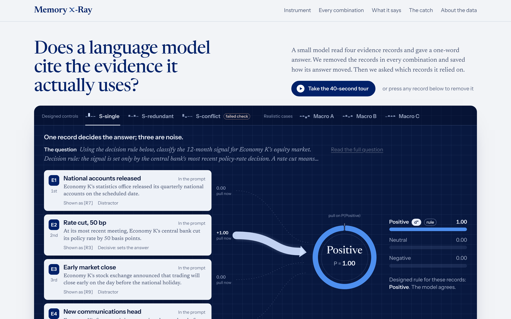

# Memory X-Ray Explorer

**Live:** https://farnooshmemari.github.io/memory-xray/

An interactive, static web page for the Memory X-Ray v0.2 experiment. Visitors can remove
evidence records and watch a small language model's answer change. They can then compare what
the model *says* it relied on with what measurably moved its answer.

Everything shown comes from the saved v0.2 results. The page runs no model and calls no API.
It needs no GPU, server, keys or network access beyond loading the page.



## What a visitor can do

- **Pick a scenario.** Choose one of six: three designed controls (S-single, S-redundant,
  S-conflict) and three realistic cases (Macro A, B, C).
- **Toggle evidence.** Press any of the four records to remove or restore it. The answer ring,
  the probability bars and the traces animate to the saved result for that exact combination.
  There are 16 combinations × 3 orderings × 6 scenarios, so 288 saved states.
- **Read the pull.** Each trace's width is how much the probability of the scenario's answer
  (d\*) changes when that record is removed. For a removed record, it is how much the
  probability changes when the record is added back.
  - An arrowhead means the record raises the probability. A bar means it lowers it.
  - A dotted trace means no pull.
- **Change the order.** Reorder the same records as the model saw them, using the three fixed
  orderings that were run.
- **Every combination.** See all 16 combinations as a lattice, with each record's Shapley value
  next to its leave-one-out value. Selecting a dot loads that combination into the instrument.
- **What it says vs what moves it.** Compare the model's own citations with the measured
  Shapley values, reply by reply. The page states plainly where the citations justify an
  *injected* decision rather than the model's own.
- **The catch.** A post hoc content-only citer never looks at the model, yet scores as well as
  the model's own citations. The page also states its caveats: the citer reads our design or
  rubric, which the model never sees, so it is not a fair competitor.
- **Take the 40-second tour.** Eight steps through real saved states.

The main findings on the page each carry one of four labels. The tour, the chart captions and
the About section follow the same distinctions in their wording.

- **Observed**: read directly from the saved results.
- **Post hoc**: an analysis defined after the results were seen.
- **Interpretation**: what we think it means.
- **Limitation**: what it cannot show.

The page never claims that the citations are, or are not, *internally* faithful. Everything is
measured from the outside by removing evidence.

## Quick start

Requirements: Node.js 20.19+ or 22.12+ and npm. Python 3.10+ is needed only to rebuild or
verify the data file.

```bash
npm ci            # install the exact locked dependencies (npm 10 or 11)
npm run dev       # local development server with hot reload
npm run build     # type-check, then build the static site into dist/
npm run preview   # serve dist/ at http://localhost:4173
```

To change dependencies, use npm 11 (`npx npm@11 install …`): in testing, npm 10 failed to
re-resolve this dependency tree, although `npm ci` from the lockfile works with either.
`npm audit` reports no known vulnerabilities.

`dist/` is self-contained: an `index.html`, one JS bundle, one CSS file, the fonts and a
favicon. Asset paths are relative, so it also works when opened from any sub-folder of a web
server.

## Deployment

GitHub Actions publishes the site with GitHub Pages. The workflow is
`.github/workflows/explorer-pages.yml` at the repository root. It runs on every push to `main`
that changes `explorer/` or the workflow itself, and it can also be started by hand from the
*Actions* tab. Each run:

1. installs with `npm ci`;
2. runs the unit tests and the data verification against the saved run files in this
   repository;
3. builds the site;
4. publishes `dist/`.

The repository's *Settings → Pages → Source* must be set to *GitHub Actions*.

**Base path.** The default build uses relative paths (`./`), which works at
`https://<user>.github.io/<repo>/` and in any sub-folder. If you prefer absolute paths, build
with `BASE_PATH=/<repo>/ npm run build`.

**Routing.** The page keeps its state in the URL hash, for example `#s_conflict/o0/m15`
(scenario, ordering, records shown). This means links to a specific view work on Pages with no
404 fallback.

## Data: where every number comes from

`src/data/explorer-data.json` is the only data the page reads. `scripts/build_data.py`
generates it from the saved v0.2 files in this repository, opening them read-only:

| Source (relative to the repository root) | Used for |
|---|---|
| `runs/full_20261017T223452Z/manifest.json` | run metadata (model, commit, device) |
| `runs/…/<scenario>/cells.jsonl` | label probabilities for all 16 subsets × 3 orderings |
| `runs/…/<scenario>/analysis.json` | Shapley values, leave-one-out values, decision d\* |
| `runs/…/<scenario>/checks.json` | pre-registered checks, including the failed S-conflict check |
| `runs/…/<scenario>/citations.jsonl` | the model's 13 citation replies per scenario and their scores |
| `runs/…/<scenario>/flips.jsonl` | counterfactual flips (realistic scenarios) |
| `scenarios/<scenario>.json` | the question, record texts, designed rule or rubric |
| `results/report_numbers.json` | pooled pre-registered numbers and post hoc splits |
| `results/post_hoc/content_only_baseline.json` | the post hoc content-only citer |

The 36 source files and their SHA-256 hashes are recorded in `meta.sources` inside the data
file.

**Hand-written content.** The only hand-written content is presentational:

- the short record labels (for example "Rate cut, 25 bp");
- the one-line scenario descriptions;
- the paraphrased record roles for the controls.

Each restates the scenario files.

**Computed in the browser.** The pull values are computed in the browser, but only as
differences between two saved probabilities: `v(S with the record) − v(S without it)`. No value
is interpolated, estimated or generated.

Rebuild and check the data (run from this folder):

```bash
npm run data:build    # regenerate src/data/explorer-data.json
npm run data:verify   # independent checks against the raw run
```

Both read the repository root, the folder above `explorer/`. Pass `-- --repo <path>` to use
another copy of the repository.

`verify_data.py` runs 93 checks, including:

- source hashes;
- all 288 cells against the independent reanalysis;
- probabilities summing to 1;
- Shapley values recomputed from all 24 permutations;
- leave-one-out values;
- every citation;
- the pooled numbers;
- the 10/7/1 content-only comparison;
- the 3 misaligned (injected-decision) orderings, and the 8 of 40 scored citations given there;
- every field the page shows directly: record texts, raw reply texts, per-scenario
  content-only scores, Shapley means and ranges, and the aligned/misaligned pools.

## Tests

```bash
npm test                          # unit tests on the data file (vitest)
npm run build && npm run test:e2e # browser tests against the production build (Playwright)
npm run screenshots               # regenerate screenshots/ (needs a build)
```

The browser tests start their own `vite preview` of `dist/` on port 4173. Set
`PW_REUSE_SERVER=1` to test a server that is already running there instead. They check that:

- **all 288 states** are displayed exactly as saved: the gauge probabilities, the bar values,
  and the pull of every trace;
- toggling, reordering, the citation layer and its injected-decision note, lattice clicks, the
  tour and keyboard use all work;
- there are no serious axe accessibility violations;
- reduced motion is respected;
- on a phone-sized screen, the answer stays in view and there is no horizontal overflow.

**Browser setup.** Run `npx playwright install chromium` once, or point the tests at an
existing Chromium with `CHROMIUM_PATH=/path/to/chrome npm run test:e2e`.

See `docs/VALIDATION.md` for the latest results.

## Project structure

```
explorer/
├── index.html                 page shell
├── public/favicon.svg
├── src/
│   ├── main.tsx               fonts and entry point
│   ├── App.tsx                page layout
│   ├── styles.css             design tokens and all styles
│   ├── data/explorer-data.json   the saved v0.2 results used by the page
│   ├── lib/
│   │   ├── model.ts           data access: v(S), pull, Shapley weights, formatting
│   │   ├── state.ts           URL-hash state, reduced-motion and media-query hooks
│   │   ├── tween.ts           number tweening for the gauge
│   │   └── types.ts
│   └── components/
│       ├── Instrument.tsx     the centerpiece: records → measured pull → decision
│       ├── Gauge.tsx          answer ring and probability bars
│       ├── ScenarioRail.tsx   scenario picker
│       ├── LatticeSection.tsx all 16 combinations; Shapley vs leave-one-out
│       ├── CitationsSection.tsx  what the model cited vs what moved it
│       ├── InsightSection.tsx the content-only citer and the main claims
│       ├── AboutSection.tsx   what was run, how to read it, limits
│       ├── Tour.tsx           the guided tour
│       ├── Tag.tsx, Glyphs.tsx
├── scripts/
│   ├── build_data.py          builds the data file from the saved results (read-only)
│   └── verify_data.py         independent data checks
├── tests/unit/                vitest
├── tests/e2e/                 Playwright: interactions, all 288 states, accessibility, screenshots
├── screenshots/               desktop (1440×900) and phone (Pixel 7) captures
├── docs/VALIDATION.md         test, review and deployment record
└── dist/                      production build (generated; not committed)
```

## Terms used on the page

- **d\*, the scenario's decision.** The answer with all four records shown, averaged over the
  three orderings. The probability tracked throughout is P(d\*).
- **Pull.** The change in P(d\*) when one record is removed from, or added back to, the
  records currently shown.
- **Leave-one-out.** The pull with all other records present.
- **Shapley value.** The pull averaged over all 8 combinations of the other records. Rows with
  0 or 3 other records weigh 1/4; rows with 1 or 2 weigh 1/12.
- **Injected decision.** The citation question was asked with d\* written into the prompt. In
  3 of 18 orderings (S-conflict orderings 0 and 1, Macro A ordering 0), the model's own answer
  differed from d\*. Its citations there justify a label it did not choose, and the page marks
  them wherever they appear.
- **n = 6.** Six scenarios, so the ranges shown are spreads across orderings, not confidence
  intervals.

## Accessibility and motion

- **Keyboard.** All controls work with the keyboard:
  - every radio group (scenarios, orderings, records to examine, citation score) uses the arrow
    keys, Home and End;
  - records are toggle buttons;
  - lattice dots respond to Enter and Space;
  - the tour pages with the arrow keys while focus is inside it, closes with Escape, and returns
    focus to the button that opened it.
- **Screen readers.** State changes are announced in a polite live region, and the charts have
  text alternatives.
- **Color.** Colors pass WCAG AA contrast, and the categorical colors were checked for
  color-vision deficiency on both the light and dark surfaces. The answer is always written
  out, never shown by color alone.
- **Reduced motion.** With `prefers-reduced-motion`, values change instantly and the decorative
  pulses are off.
- **Narrow screens.** The answer panel stays pinned while you toggle records, and the charts
  switch to layouts sized for a phone.

## Relationship to the rest of the repository

The explorer reads the saved results only through `scripts/build_data.py`, when the data file
is rebuilt. It imports nothing from the rest of the repository at runtime, and nothing in it
writes outside `explorer/`.

## License

MIT © 2026 Farnoosh Memari. See `LICENSE`.
