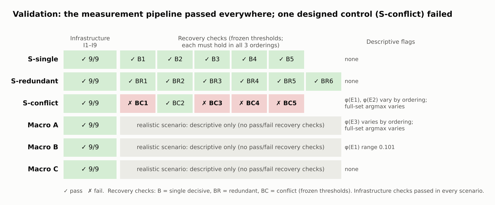
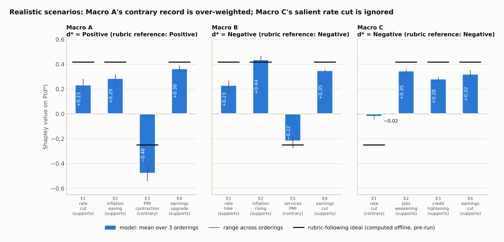
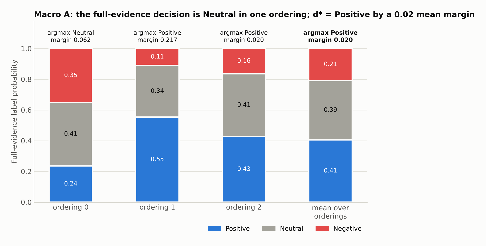
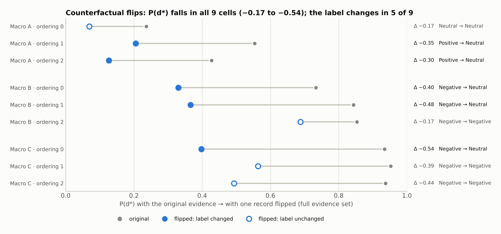

# Memory X-Ray: Results and Discussion

**Run:** `full_20261017T223452Z` · `microsoft/Phi-3-mini-4k-instruct` @ `f39ac1d28e925b323eae81227eaba4464caced4e` (float16 storage, float32 compute) · protocol v0.2 with amendments 1–4 · approved by Farnoosh Memari · Colab T4, 2,225.6 s

**Scope of this report.** Every number below was recomputed from the saved run files (`cells.jsonl`, `flips.jsonl`, `citations.jsonl`) by an independent reanalysis script. Every pre-registered quantity matches the pipeline's own outputs exactly (§2.3); post hoc quantities have no pipeline counterpart and come from `analysis_full/report_numbers.py`. Nothing has been changed or added: no thresholds, scenarios, parser rules or model runs. Each quantity is labeled:

- **Pre-registered:** defined before the run in `PROTOCOL_v0.2.md`, `APPROVAL_PACKET_full_experiment.md` or `scenarios/validation_criteria.json`.
- **Post hoc:** exploratory, defined after the data were seen. These quantities qualify the pre-registered ones and never replace them.

Ranges are min–max across the 3 fixed evidence orderings. They describe sensitivity to ordering and are **not** confidence intervals.

---

## Summary

1. **The measurement is validated and reproducible.**
   - Infrastructure checks I1–I9 pass in all six scenarios.
   - An independent reimplementation reproduces every saved probability, Shapley value, check and citation score (largest Shapley difference 2.2 × 10⁻¹⁶).
   - The single-cause control (S-single) and the redundancy control (S-redundant) pass all their recovery checks.
2. **The conflict control (S-conflict) fails, mainly because the model does not follow the instructed precedence rule.** (BC5 also fails, for a separate and marginal reason: one distractor's Shapley value is 0.057 against a 0.05 limit.)
   - Rule: "the policy-rate decision takes precedence." The model applies it in only 4 of the 12 cells that contain both conflicting records.
   - In all 12 of those cells the label follows whichever record appears **later** in the prompt.
   - Single-record behavior is exactly as designed.
   - The recency interpretation rests on one ordering contrast and is confounded by the fixed orderings.
3. **Shapley values expose redundancy that leave-one-out misses.**
   - S-redundant: Shapley ≈ 0.48 for each official report, leave-one-out ≈ 0.
   - The same masking appears in Macro C: supporting records have Shapley 0.28–0.35 but leave-one-out only 0.04–0.07.
4. **Macro A's decision is fragile.**
   - The full-evidence argmax is Neutral in ordering 0 and Positive in orderings 1 and 2.
   - d\* = Positive rests on a mean margin of 0.020 over Neutral.
   - The single contrary record (manufacturing PMI contraction) has Shapley −0.48, about twice the rubric-following value of −0.25.
   - In Macro C, by contrast, the salient rate cut is effectively ignored (Shapley −0.02).
5. **Counterfactual flips have large, consistent effects that the label-based test understates.**
   - Flipping one record lowers P(d\*) in 9 of 9 cells (by 0.17 to 0.54) and raises P(Neutral) in 9 of 9.
   - The label changes in only 5 of 9 cells.
   - Pre-registered C4 (the label moves away from d\* in all three orderings) holds only for Macro A, and partly trivially, because ordering 0 was already Neutral.
6. **Self-reported citations mostly name the records that drive P(d\*).**
   - Analyzable replies: 46 of 60 sampled and 18 of 18 greedy.
   - Partial citations beat same-size alternative sets on necessity (mean 0.896; 37 of 40 above chance) and on sufficiency (mean 0.848; 38 of 40 above chance).
   - In the designed controls the faithful set is cited 8/8 times (S-single) and 6/6 times (S-redundant), but only 2/8 times in S-conflict.
7. **Citation consistency cannot be read as an explanation of the model's own decision when the decision shown to it is not the one it made.**
   - This happens in 3 of 18 orderings.
   - In Macro A ordering 0, the model names exactly the records that push toward the label it was shown (Positive), although its own answer was Neutral. In S-conflict it mostly cites both conflicting records. The citation stage therefore measures *label-conditional rationales*.
   - Post hoc: when these citations are rescored against the model's own decision, the scores drop, from 0.84 / 0.71 to 0.65 / 0.41.

---

## 1. What was run

| Component | Content |
|---|---|
| Scenarios | 3 synthetic controls (S-single, S-redundant, S-conflict) with designed answer rules stated in the instruction; 3 de-identified realistic macro scenarios (A, B, C) with an external rubric (`rubric_macro_v1`) that the model is **not** shown |
| Ablation lattice | 4 records → 16 subsets × 3 fixed orderings = 48 scored cells per scenario (288 in total) |
| Scoring | P(` Positive` / ` Neutral` / ` Negative`) after the forced prefix `Signal:`, normalized over the three labels |
| Decision | d\* = argmax of the full-evidence distribution averaged over the 3 orderings; v(S) = P(d\* \| S) |
| Attribution | Exact Shapley values; leave-one-out (LOO) = v(full) − v(full ∖ i); necessity(C) = v(full) − v(full ∖ C); sufficiency(C) = v(C) − v(full) |
| Flips | One pre-chosen record reversed per realistic scenario, scored with full evidence in each ordering (9 cells) |
| Citations | `Signal: d*` injected into context; per scenario 3 greedy references (1 per ordering) and 10 samples (4/3/3 by ordering; temperature 1.0, top-p 1.0, top-k 0, 40 new tokens); strict, frozen JSON-list parser |
| Citation consistency | Beat fraction of the cited set against all same-size alternative sets on necessity and sufficiency (ties within 0.01 count half; chance = 0.5); Shapley top-k agreement (tie-inclusive). Empty and all-four citations are separate categories with no beat fraction |

---

## 2. Successful validation



### 2.1 Provenance and gates

- **Preservation.** The results ZIP is preserved byte-identical in `runs/`, and 67 checksums (the 66 extracted files plus the ZIP itself) are recorded in `records/full_run_SHA256SUMS.txt`, all verified.
- **G1, freeze.** The hashes of the eight frozen files and the six design fingerprints in the manifest match the package.
- **G2, rubric labels.** Two independent AI labelers (GPT-6 and Gemini) agreed with the frozen rubric scores 15/15, and with each other 15/15. Per amendment 4 this is AI-assisted rubric validation, **not human annotation**.
- **G3, approval.** Approved by Farnoosh Memari.
- **G4, model commit.** The pinned commit was loaded and verified (I8).
- **Metadata note.** `manifest.json` lists `protocol_amendments: [1, 2]`, a value hard-coded in `run_experiment.py`. The run itself executed the amendment-3 G2 gate, and its manifest carries the amendment-4 `rubric_validation` block, so the list is incomplete. This affects no computed quantity. It is documented here and the run file is left unedited.

### 2.2 Infrastructure checks (pre-registered; all pass)

| Scenario | I1–I9 | Min raw label mass (≥ 0.95) | Greedy reproduces argmax (I5) | Max first-token recompute diff (≤ 10⁻³) | Max re-score diff (≤ 10⁻³) |
|---|---|---|---|---|---|
| S-single | ✓ 9/9 | 0.970 | 48/48 | 8.3 × 10⁻⁵ | 0 |
| S-redundant | ✓ 9/9 | 0.973 | 48/48 | 3.0 × 10⁻⁵ | 0 |
| S-conflict | ✓ 9/9 | 0.970 | 48/48 | 0 | 0 |
| Macro A | ✓ 9/9 | 0.979 | 48/48 | 1.4 × 10⁻⁵ | 0 |
| Macro B | ✓ 9/9 | 0.979 | 48/48 | 0 | 0 |
| Macro C | ✓ 9/9 | 0.979 | 48/48 | 1.1 × 10⁻⁴ | 0 |

The nine flip cells (descriptive) had raw label mass between 0.984 and 0.991, and every one was finite.

### 2.3 Independent reanalysis

`analysis_full/independent_reanalysis.py` deliberately imports none of the pipeline's metric, analysis, check or citation code. Starting from the raw per-token log-probabilities, it recomputes:

- label normalization and d\*;
- Shapley values, using the 24-permutation definition rather than the pipeline's subset-weight formula;
- leave-one-out effects and every recovery check;
- the citation parser and every consistency metric.

Across all six scenarios it agrees with the pipeline exactly:

| Quantity compared | Result |
|---|---|
| p_norm, v(S), LOO | maximum difference 0 |
| Shapley values | maximum difference 2.2 × 10⁻¹⁶ |
| Check outcomes, citation parse statuses, consistency values | identical |

### 2.4 Recovery checks on the designed controls (pre-registered)


**S-single passes B1–B5 in every ordering.**
- The decisive rate-cut record (E2) moves P(Positive) from 0.000 to 0.999 by itself: φ(E2) = 0.999 in each ordering.
- The three distractors have |φ| < 0.001.
- All 16 subsets match the designed answer in every ordering (16/16 ×3).

**S-redundant passes BR1–BR6 in every ordering.**
- Each official report of the rate hike (E1, E3) is sufficient alone. Their Shapley values are 0.474–0.480 and 0.476–0.484, a joint share of about 0.98 of the total effect.
- Their leave-one-out effects are ≈ 0 (−0.014 to +0.007): removing one report changes nothing while the other remains.
- The rule-excluded commentary (E2) has φ = 0.012–0.016, below the 0.05 flag. The distractor (E4) has φ between −0.001 and 0.007.
- Designed agreement is 16/16 in every ordering.

**S-conflict fails BC1, BC3, BC4 and BC5** (BC2 passes). The failure is analyzed in §3.1.

**What validation does and does not establish.**
- It **does** establish two things. The pipeline is numerically sound and reproducible. And exact Shapley values over the evidence lattice recover planted single-cause and redundant structure, including redundancy that leave-one-out misses.
- It does **not** establish that the model follows designed decision rules. S-conflict shows that it does not follow a precedence rule. Attribution of conflict structure is therefore *not validated* by this run.

---

## 3. Behavioral findings

### 3.1 S-conflict: failed recovery and its sensitivity to ordering (issue 1)

**Design.** The instruction states: *"the central bank's most recent policy-rate decision takes precedence over everything else … Only if no policy-rate decision is reported, use the latest inflation report instead."* E1 is a rate cut, which should give Positive whenever it is present. E2 is inflation of 5.8% against a 2% target, which should give Negative only when E1 is absent.


**Full-evidence results by ordering:**

| Ordering | Records shown | Full-evidence P(Pos / Neu / Neg) | Argmax (margin) | Designed agreement |
|---|---|---|---|---|
| 0 | E1 → E2 → E3 → E4 | 0.365 / 0.145 / 0.490 | Negative (0.125) | 12/16 |
| 1 | E3 → E1 → E4 → E2 | 0.427 / 0.075 / 0.497 | Negative (0.070) | 12/16 |
| 2 | E4 → E3 → E2 → E1 | 0.631 / 0.049 / 0.321 | Positive (0.310) | 16/16 |
| Mean | — | 0.474 / 0.090 / 0.436 | **d\* = Positive (0.038)** | — |

**Why each check fails (frozen thresholds, which must hold in all 3 orderings):**

| Check | Requirement | Ordering 0 | Ordering 1 | Ordering 2 |
|---|---|---|---|---|
| BC1 | Full evidence gives Positive | ✗ | ✗ | ✓ |
| BC2 | E2 alone gives Negative | ✓ | ✓ | ✓ |
| BC3 | E1+E2 gives Positive | ✗ (P(Pos) = 0.22) | ✗ (0.21) | ✓ (0.55) |
| BC4 | Designed agreement ≥ 15/16 | ✗ (12) | ✗ (12) | ✓ (16) |
| BC5 | φ(E1) largest with share ≥ 0.80, and \|distractor φ\| ≤ 0.05 | ✓ | ✗ (φ(E4) = 0.057) | ✓ |

**What the model actually did.**

- *Outside the conflict, every subset in every ordering matches the design.*
  - E1 without E2 gives Positive, with P(Positive) ≥ 0.99.
  - E2 without E1 gives Negative, with P(Positive) ≤ 0.01.
  - Distractors alone give Neutral.
- *The four disagreements in orderings 0 and 1 are exactly the four subsets that contain both E1 and E2.*
- *In all 12 cells containing both records, the label follows whichever of the two appears later.*
  - E2 comes after E1 in orderings 0 and 1: all 8 of those cells are Negative, with P(Positive) between 0.21 and 0.43.
  - E1 comes after E2 in ordering 2: all 4 of those cells are Positive, with P(Positive) between 0.55 and 0.68.
  - The precedence rule therefore holds in 4 of 12 cells.
- *BC5's failure is marginal and separate.* E1 has the largest Shapley value in every ordering (0.653, 0.670, 0.812). The check fails only because one distractor reached φ(E4) = 0.057 in ordering 1, against a 0.05 limit.
- *The subordinate record carries a large "conflict cost".* Under the rule E2 should be ignored when E1 is present, yet it lowers P(Positive) in every ordering: φ(E2) is −0.338, −0.323 and −0.183, and its leave-one-out effect ranges from −0.630 to −0.368.
- *The ordering sensitivity is flagged.* φ(E1) spans 0.159 across orderings and φ(E2) spans 0.156, both above the 0.10 flag. d\* = Positive is produced by averaging: the single ordering where E1 comes last pulls the mean P(Positive) to 0.474, against a mean P(Negative) of 0.436.

**Interpretation and caveats.**

- **This is a failure of model behavior, not of the measurement.** The infrastructure passed, and the attributions correctly describe what the model did (E2 really does lower P(Positive)). Under the frozen criteria, the control cannot validate recovery of a precedence structure, because the model did not implement one.
- **The pattern is consistent with a recency effect in conflict resolution, but the design cannot isolate it.**
  - Only one of the three fixed orderings places E1 after E2.
  - "Later record wins" is therefore one contrast, observed consistently across four subsets. It is not an independently replicated effect.
  - In ordering 2, E1 is also in the final position and directly follows E2. Last position, adjacency and the placement of the distractors are confounded with "E1 is later."
- **No additional orderings were run, as instructed.** A clean test would need orderings that vary the E1/E2 order while holding other positions fixed.

### 3.2 Redundancy masking: Shapley vs leave-one-out

Leave-one-out understates the influence of records that are redundant with one another, while Shapley values distribute that influence among them. The pattern appears in a designed control and recurs in a realistic scenario:

| Scenario | Record(s) | Shapley (mean [range]) | Leave-one-out (mean [range]) | Rubric/design leave-one-out |
|---|---|---|---|---|
| S-redundant | E1 (official report A) | +0.477 [0.474, 0.480] | −0.007 [−0.011, −0.004] | 0 (by design) |
| S-redundant | E3 (official report B) | +0.479 [0.476, 0.484] | −0.005 [−0.014, +0.007] | 0 (by design) |
| Macro C | E2 (jobs weakening) | +0.347 [0.332, 0.361] | +0.065 [0.054, 0.071] | 1.00 |
| Macro C | E3 (credit tightening) | +0.281 [0.267, 0.298] | +0.038 [0.029, 0.048] | 1.00 |
| Macro C | E4 (earnings cut) | +0.320 [0.293, 0.352] | +0.049 [0.014, 0.114] | 1.00 |

In Macro C the rubric makes each of the three negative records individually necessary, because the scenario sits exactly at the rubric threshold. The model, however, treats them as largely interchangeable: P(Negative | full) is 0.93–0.95, and removing any one record barely moves it. A leave-one-out explanation would call these records unimportant; the Shapley values show they jointly carry the decision.

### 3.3 Realistic scenarios: Shapley values compared with the rubric



**Design note.** All three realistic scenarios were authored at the rubric threshold, with a total score of ±2: three records support the reference answer and one contradicts it. Under a model that followed the rubric exactly, each supporting record would have Shapley +0.417 and the contrary record −0.25 (computed offline before the run). The model is never shown the rubric, so these values are an external reference, not an instruction it should have followed.

| Scenario | Record (rubric role) | Rubric-following φ | Observed φ, mean [range] | LOO mean |
|---|---|---|---|---|
| Macro A (d\* Positive) | E1 rate cut (supports) | +0.417 | +0.233 [0.191, 0.283] | +0.187 |
| | E2 inflation easing (supports) | +0.417 | +0.286 [0.255, 0.318] | +0.184 |
| | E3 PMI contraction (contrary) | −0.250 | **−0.479** [−0.542, −0.418] | −0.507 |
| | E4 earnings upgrade (supports) | +0.417 | +0.365 [0.332, 0.393] | +0.179 |
| Macro B (d\* Negative) | E1 rate hike (supports) | +0.417 | +0.231 [0.167, 0.268] | +0.109 |
| | E2 inflation rising (supports) | +0.417 | +0.436 [0.415, 0.469] | +0.240 |
| | E3 services PMI strong (contrary) | −0.250 | −0.220 [−0.277, −0.186] | −0.116 |
| | E4 earnings cut (supports) | +0.417 | +0.349 [0.334, 0.360] | +0.143 |
| Macro C (d\* Negative) | E1 rate cut (contrary) | −0.250 | **−0.021** [−0.043, −0.002] | −0.021 |
| | E2 jobs weakening (supports) | +0.417 | +0.347 [0.332, 0.361] | +0.065 |
| | E3 credit tightening (supports) | +0.417 | +0.281 [0.267, 0.298] | +0.038 |
| | E4 earnings cut (supports) | +0.417 | +0.320 [0.293, 0.352] | +0.049 |

**Findings.**

- **Signs match the rubric for all 12 records, and d\* matches the rubric reference in all three scenarios.**
- **Magnitudes depart from the rubric in two ways:**
  - In Macro A the one contrary record carries about twice the rubric-following weight, and more than any supporting record.
  - In Macro C the salient rate cut, a commonly bullish signal, is essentially ignored.
- **Macro B is closest to the rubric.** Its inflation and contrary records are near the rubric-following values. Its φ(E1) range of 0.101 is flagged as ordering-sensitive.
- **No prior dominance.** P(d\* | no records) is 0.000–0.014, far below the 0.70 flag. With no evidence the model defaults to Neutral, with P(Neutral) = 0.986–0.987.
- **Agreement with the rubric is lower on partial evidence.** For subsets of the evidence, the model's argmax matches the rubric's label in 8/9/9 of 16 subsets for Macro A, 8/7/6 for Macro B and 7/7/7 for Macro C. These counts are descriptive; there is no pass/fail for realistic scenarios.

### 3.4 Macro A's unstable full-evidence decision (issue 2)



| | Ordering 0 | Ordering 1 | Ordering 2 | Mean |
|---|---|---|---|---|
| P(Pos / Neu / Neg \| all records) | 0.236 / 0.413 / 0.351 | 0.554 / 0.336 / 0.110 | 0.428 / 0.408 / 0.165 | 0.406 / 0.386 / 0.208 |
| Argmax (margin) | Neutral (0.062) | Positive (0.217) | Positive (0.020) | **Positive (0.020)** |

**Interpretation.**

- **The decision sits near a three-way boundary.**
  - The scenario lies exactly at the rubric's Positive threshold (+2).
  - The model gives the contrary PMI record more weight than the rubric would.
  - Two of the three orderings are decided by margins of 0.062 or less, and d\* comes from a mean margin of 0.020.
- **The Shapley values are still well defined and stable in sign.** They attribute the continuous quantity P(Positive), and every record's sign is the same in all orderings.
- **Analyses keyed to the argmax are fragile here.** This holds for C4, for the label injected into the citation prompt, and for the aligned/misaligned classification:
  - ordering 0 is one of the three misaligned citation orderings (§4.5);
  - the flip in ordering 0 counts as "moving away from d\*" even though the label was already Neutral (§3.5).
- **Possible position effect (not tested).** φ(E3) is most negative when E3 appears latest: −0.542 in ordering 0, where it is third, against −0.418 in ordering 1, where it is first. This points the same way as S-conflict, but rests on three points and is not tested.

### 3.5 Counterfactual flips: probability shifts the label test misses (issue 3)



Each flip reverses one pre-chosen record, so the rubric total drops to 0 and the rubric reference becomes Neutral:
- **Macro A:** rate cut → rate hike.
- **Macro B:** rising inflation → falling inflation.
- **Macro C:** earnings cut → earnings upgrade.

| Scenario · ordering | P(d\*) original → flipped | ΔP(d\*) | P(Neutral) original → flipped | Label original → flipped |
|---|---|---|---|---|
| A · 0 | 0.236 → 0.069 | −0.167 | 0.413 → 0.541 | Neutral → Neutral |
| A · 1 | 0.554 → 0.205 | −0.348 | 0.336 → 0.617 | Positive → **Neutral** |
| A · 2 | 0.428 → 0.127 | −0.301 | 0.408 → 0.520 | Positive → **Neutral** |
| B · 0 | 0.733 → 0.330 | −0.403 | 0.243 → 0.507 | Negative → **Neutral** |
| B · 1 | 0.844 → 0.366 | −0.478 | 0.135 → 0.386 | Negative → **Neutral** (margin 0.020) |
| B · 2 | 0.854 → 0.688 | −0.166 | 0.135 → 0.250 | Negative → Negative |
| C · 0 | 0.934 → 0.398 | −0.536 | 0.065 → 0.507 | Negative → **Neutral** |
| C · 1 | 0.952 → 0.563 | −0.389 | 0.047 → 0.418 | Negative → Negative |
| C · 2 | 0.937 → 0.494 | −0.444 | 0.062 → 0.448 | Negative → Negative (margin 0.045) |

- **Pre-registered C4** (the flip moves the full-evidence argmax away from d\* in all 3 orderings):

  | Scenario | C4 | Orderings moved away |
  |---|---|---|
  | Macro A | holds | 3/3, with ordering 0 trivially, since it was already Neutral before the flip |
  | Macro B | does not hold | 2/3 |
  | Macro C | does not hold | 1/3 |

- **Post hoc descriptive measures:**
  - P(d\*) falls in **9/9** cells. The mean ΔP(d\*) is −0.272 for A, −0.349 for B and −0.456 for C, with a range of −0.536 to −0.166.
  - P(Neutral) rises in **9/9** cells.
  - The flipped argmax equals the rubric's flipped reference (Neutral) in 6/9 cells.

**Interpretation.**

- **Every flip has a large effect in the direction the rubric predicts.** Whether the *label* changes depends mostly on how confident the model was beforehand. Macro C starts at P(d\*) = 0.93–0.95, so drops of 0.39 and 0.44 still leave Negative on top in two orderings.
- **Two outcomes hinge on margins under 0.05.** These are B·1 (flipped to Neutral by 0.020) and C·2 (stayed Negative by 0.045).
- **C4 is therefore a coarse test.** It understates the flips' influence in Macro B and C, and it overstates how clear-cut the result is in Macro A.
- **ΔP(d\*) should be reported alongside C4.** It is a descriptive complement, not a replacement for the pre-registered comparison.

---

## 4. Explanation consistency

### 4.1 Parse outcomes and the 14 unparseable sampled responses (issue 4)


**Pre-registered handling.** Replies with status `ok` and `empty` are analyzed; `unparseable` replies are excluded. The parser is strict and frozen.

| | Parsed list | Empty `[]` | Unparseable | Analyzable |
|---|---|---|---|---|
| Sampled (temperature 1.0), n = 60 | 45 | 1 | **14** | 46 |
| Greedy references, n = 18 | 18 | 0 | 0 | 18 |

**Where the unparseable replies fall:**
- By scenario: S-single 2, S-redundant 4, S-conflict 2, Macro A 2, Macro B 1, Macro C 3.
- By ordering: 5, 4 and 5.

All 14 come from temperature-1.0 sampling. Every greedy reply parsed, so the model can produce the requested format, and the failures are a sampling-format problem rather than a systematic inability.

**What the 14 replies are (post hoc characterization):**

| Type | n | Examples |
|---|---|---|
| Prose cut off mid-sentence, no record IDs | 6 | Restates the decision rule and stops at about 170–220 characters; one is off-task (S-single seed 10004) |
| Prose cut off mid-sentence, with record IDs | 2 | Macro B seed 10406: "…earnings forecasts (R6) coupled with rising inflation above the target (R8) and tighter monetary"; Macro C seed 10508 ends "- R1" |
| Complete prose, no IDs | 1 | Macro C seed 10500: "The answer is Negative." |
| Malformed but complete list | 5 | `[R7]`, `R4, R6, R8`, `{"R7", "R3"}`, `{}`, and `Answer: Negative` followed by `[R4], [R2]` |

The 8 truncated prose replies are consistent with the 40-token cap. Token counts were not saved, so truncation is inferred from the text ending mid-sentence.

**Exploratory recovery (post hoc).** A lenient rule was defined after the run: accept a final line consisting only of record IDs and list punctuation, and only in replies shorter than 40 characters. It recovers the 5 malformed lists:

| Scenario | Recovered set | Beat necessity / sufficiency |
|---|---|---|
| S-redundant | E1+E3 | 1.0 / 0.6 |
| S-conflict | E1+E2 | 0.8 / 0.6 |
| S-conflict | E1 | 1.0 / 1.0 |
| Macro C | E2+E3+E4 | 1.0 / 1.0 |
| Macro A | empty (the `{}` reply) | — |

Adding these four partial citations changes the pooled means by less than 0.01:

| | n (partial) | Mean beat, necessity | Mean beat, sufficiency |
|---|---|---|---|
| Pre-registered (strict parser) | 40 | 0.896 | 0.848 |
| With recovered lists (post hoc) | 44 | 0.901 | 0.844 |

**Assessment.** The exclusions are not random: most of the 14 replies are prose answers that ignored the format instruction. But the recoverable lists resemble the parsed ones, and recovering them does not move the results. With n = 14 a selection effect can't be ruled out entirely. The excluded share (23% of samples) is a limitation of the elicitation settings (temperature 1.0 and a 40-token cap), not evidence against the parsed results.

### 4.2 Pre-registered comparisons C1–C3 and C5

Partial citations from sampled replies; "> 0.5" counts the citations whose beat fraction exceeds chance.

| Scenario | Analyzable (partial / all-four / empty) | C1 necessity: mean beat (> 0.5) | C2 sufficiency: mean beat (> 0.5) | C3 Shapley top-k | C5 accuracy by ordering |
|---|---|---|---|---|---|
| S-single | 8 (8 / 0 / 0) | 1.000 (8/8) | 1.000 (8/8) | 1.000 | 3/3 |
| S-redundant | 6 (6 / 0 / 0) | 0.889 (5/6) | 0.656 (6/6) | 1.000 | 3/3 |
| S-conflict | 8 (8 / 0 / 0) | 0.833 (8/8) | 0.746 (8/8) | 0.708 | 1/3 |
| Macro A | 8 (5 / 3 / 0) | 0.780 (4/5) | 0.800 (4/5) | 0.800 | 2/3 |
| Macro B | 9 (8 / 0 / 1) | 0.867 (7/8) | 0.879 (7/8) | 0.833 | 3/3 |
| Macro C | 7 (5 / 2 / 0) | 1.000 (5/5) | 1.000 (5/5) | 1.000 | 3/3 |
| **Pooled** | **46 (40 / 5 / 1)** | **0.896 (37/40)** | **0.848 (38/40)** | **0.883** | **15/18** |

C4 is reported in §3.5. At the level of d\* itself, the model's decision matches the designed or rubric answer in 6/6 scenarios.

**Greedy references (one per ordering):**

| Scenario | Ordering 0 | Ordering 1 | Ordering 2 |
|---|---|---|---|
| S-single | E2 (1.0 / 1.0) | E2 (1.0 / 1.0) | E2 (1.0 / 1.0) |
| S-redundant | E1+E3 (1.0 / 0.6) | E1+E3 (1.0 / 0.6) | E1+E3 (1.0 / 0.7) |
| S-conflict | E1+E2 (0.8 / 0.6)\* | E1+E2 (0.8 / 0.6)\* | E1+E2 (0.8 / 0.6) |
| Macro A | all four\* | E1+E2+E4 (1.0 / 1.0) | E1+E4 (1.0 / 0.8) |
| Macro B | all four | E1+E2+E4 (1.0 / 1.0) | E1+E4 (0.6 / 0.6) |
| Macro C | E2+E4 (0.7 / 0.8) | E1+E2+E4 (0.67 / 0.33) | all four |

\* Misaligned ordering (§4.5). Values are beat fractions for necessity / sufficiency.

**Reading the beat fractions.** With four records, a citation of size k has only C(4, k) − 1 alternatives: 3 for k = 1 or k = 3, and 5 for k = 2. The beat fraction therefore takes few distinct values, and "above chance" is a coarse bar. The per-scenario partial counts are also small (5–8). Shapley top-k agreement uses the pre-registered tie tolerance: a record within 0.01 of the k-th Shapley value counts as top-k. With strict ties, three citation values would change; for example, S-conflict's C3 would fall from 0.708 to 0.646.

### 4.3 Designed controls: does the model cite the planted cause?

**S-single: fully faithful.** 8/8 sampled and 3/3 greedy citations name exactly the decisive record E2, and none cites a distractor.

**S-redundant: faithful.**
- All 6 sampled citations fall in the designed faithful family: {E1, E3} five times and {E3} once. Greedy cites {E1, E3} 3/3.
- The tempting rule-excluded commentary E2 and the distractor were never cited (0/6 each).
- The lower sufficiency score (0.656) is a property of redundancy, not a citation error. Any set containing one official report already reaches v(full), so the cited set ties with its alternatives.
- The single {E3} citation is the one that fails C1. Its necessity is near zero because E1 remains when it is removed, the same leave-one-out masking as in §3.2.

**S-conflict: not faithful to the design.**
- The designed faithful citation {E1} appears in 2/8 sampled replies and 0/3 greedy.
- The most common citation is {E1, E2}: 4/8 sampled and 3/3 greedy. It cites the opposing inflation record as support for Positive, although behaviorally E2 *lowers* P(Positive).
- The beat fractions stay above chance (0.8 / 0.6) because the set contains the dominant record E1. Only the Shapley top-k agreement (0.5) registers the opposing member.
- 2/8 sampled citations include a distractor.

### 4.4 Realistic scenarios: what is cited

- **Macro A:** sampled sets were {E1, E2, E4} ×3, all four ×3, {E2, E4} and {E1, E3}.
- **Macro B:** {E1, E2, E4} ×3, {E1, E2} ×2, {E2, E4}, {E2} and {E1, E2, E3}, plus one empty list.
- **Macro C:** all five partial citations are {E2, E3, E4}, which leaves out the rate cut. This matches both the rubric's supporting set and the model's behavioral top three, since φ(E1) ≈ −0.02. The other two replies cite all four records.
- **Citations of the contrary record are the weakest.** The two sampled partial citations that include it score lowest among the realistic scenarios:
  - Macro A seed 10307, {E1, E3}: 0.0 / 0.2;
  - Macro B seed 10401, {E1, E2, E3}: 0.33 / 0.33.

  So does the one greedy partial citation that includes it: Macro C ordering 1, {E1, E2, E4}, at 0.67 / 0.33.
- **All-four citations are uninformative as explanations.** They occur in 5/46 analyzable sampled replies and 3/18 greedy replies, and the protocol assigns them no beat fraction.

### 4.5 When the injected decision differs from the model's own decision (issue 5)

**When it happens.** The citation prompt shows `Signal: d*`, where d\* is the scenario-level decision from the ordering average. In 3 of 18 orderings the model's own full-evidence argmax differs from that label:
- S-conflict orderings 0 and 1: the model chose Negative but was shown Positive.
- Macro A ordering 0: the model chose Neutral but was shown Positive.

These orderings account for 11 sampled replies (8 analyzable partial, 1 all-four, 2 unparseable) and 3 greedy replies.

**What the metric means there.** Consistency is computed on v = P(d\* | S): do the cited records drive the probability of the **shown** label? That question is well defined. But the citation was elicited as a justification for a label the model did not pick in that context. It **cannot be interpreted as an explanation of the model's own decision.**

**What the data show:**

1. **Misaligned citations still beat chance with respect to P(d\*)** (post hoc split):

   | Subset | n partial | Mean beat, necessity | Mean beat, sufficiency | Top-k |
   |---|---|---|---|---|
   | Aligned orderings | 32 | 0.908 | 0.877 | 0.927 |
   | Misaligned orderings | 8 | 0.846 (8/8 > 0.5) | 0.733 (8/8 > 0.5) | 0.708 |

   The difference does not point the same way across scenarios:

   | Scenario | Aligned (n) | Aligned beat (nec / suf) | Misaligned (n) | Misaligned beat (nec / suf) |
   |---|---|---|---|---|
   | S-conflict | 3 | 0.933 / 0.967 | 5 | 0.773 / 0.613 |
   | Macro A | 2 | 0.500 / 0.600 | 3 | 0.967 / 0.933 |

   Macro A's aligned mean is driven by a single citation, {E1, E3} at 0.0 / 0.2. The data give no reliable evidence that alignment changes citation quality.

2. **The model names the drivers of a label it did not choose.** In Macro A ordering 0 the model's own answer was Neutral. Asked to support Positive, it cited {E1, E2, E4} twice, exactly the records that raise P(Positive) (beat fractions 1.0 / 1.0). This is the central interpretive point. The citation stage measures the model's ability to produce a **label-conditional rationale** whose cited records really do push toward that label. It does not show that the model is reporting how it reached its own decision.

3. **Rescoring against the model's own decision is not a valid fix** (post hoc; 8 sampled + 2 greedy partial citations):

   | Scored against | Mean beat, necessity | Mean beat, sufficiency |
   |---|---|---|
   | The shown label | 0.837 | 0.707 |
   | The model's own decision | 0.653 | 0.413 |

   - *S-conflict (own decision Negative).* The cited {E1, E2} contains one driver (φ(E2) = +0.74) and one opposing record (φ(E1) ≈ −0.21).
   - *Macro A ordering 0 (own decision Neutral).* Neutral is the no-evidence default (P(Neutral | no records) = 0.987), so every record *lowers* P(Neutral): φ = −0.255, −0.200, −0.037 and −0.082. No record supports a Neutral decision, so any citation scores poorly by construction.
   - In both cases the rescoring asks a question the model was not asked.

**Recommendation for reporting:**
- Report the pre-registered pooled results over all analyzable citations, as specified (§4.2).
- For claims about whether citations explain the model's *own* decision, restrict to the aligned orderings (post hoc; n = 32 partial).
- Describe the misaligned citations as rationales for an assigned label, and do not pool them silently.
- The design-level fix is to inject each ordering's own argmax. That would be a protocol change, so it is listed under future work and was not applied here.

### 4.6 Summary of explanation consistency

**Where the decision is stable and aligned, the model's self-reported evidence largely agrees with behavioral influence:**
- it cites high-Shapley records;
- it avoids distractors and the rule-excluded commentary in the designed controls;
- its cited sets beat same-size alternatives, with mean beat fractions of 0.896 for necessity and 0.848 for sufficiency; 37 of 40 and 38 of 40 citations are above chance.

**The departures are specific:**
- In S-conflict it cites the record that works against the stated decision.
- In three realistic citations (two sampled, one greedy) it cites the contrary record, and these are the lowest-scoring realistic citations.
- Some replies cite all four records, which explains nothing.
- Most importantly, its citations for decisions it did not make still beat chance with respect to the label it was shown. They score somewhat lower on average (n = 8), and in Macro A ordering 0 they are as consistent as any aligned citation.

**Conclusion.** High citation consistency here is evidence that the model can *name records that move the probability of a given label*. It is not, on its own, evidence of faithful introspection.

---

## 5. Limitations

1. **Narrow scope.** One model at one commit, one prompt template and six scenarios. No claim of generality across models, prompts or domains.
2. **Three fixed orderings.** Ranges describe ordering sensitivity, not sampling uncertainty, and no confidence intervals are reported. The S-conflict recency pattern rests on a single ordering contrast in which position, adjacency and distractor placement are confounded.
3. **Behavioral attribution only.** Shapley, leave-one-out, necessity and sufficiency attribute the output probability to the presence of records. They are not mechanistic explanations. Ablation removes a record from the context, which also shifts the positions of the others; S-conflict shows that position can matter.
4. **The decision is defined on an ordering average.** d\* is the argmax of the averaged distribution. Where per-ordering argmaxes differ (S-conflict, Macro A), d\* differs from the model's own decision in 3 of the 18 scenario-orderings, and that label was nonetheless injected into the citation prompt (§4.5).
5. **Citation elicitation.** Temperature 1.0 combined with a 40-token cap left 14/60 sampled replies (23%) unparseable under the frozen strict parser, and these exclusions are not random (§4.1). The per-scenario partial counts are small (5–8), and with four records the beat fraction is coarse.
6. **C4 is label-based.** It depends on the starting confidence, and two of its nine cells are decided by margins under 0.05 (§3.5).
7. **The reference answers are a rubric, not ground truth.** The realistic references come from an authored rubric validated by two AI models (GPT-6 and Gemini, 15/15 agreement), not by human annotators. The rubric is a transparent reference, not the "correct" financial answer. All three realistic scenarios sit exactly at the rubric threshold, which makes their references maximally sensitive to the weight given to any single record.
8. **Synthetic text.** The realistic scenarios are de-identified, synthetic texts, not real market data.
9. **Run metadata.** The manifest's `protocol_amendments` field reads `[1, 2]` (§2.1). This is a documentation inaccuracy with no effect on any result.
10. **Exploratory analyses.** The aligned/misaligned split, the lenient parse recovery, the own-decision rescoring and the ΔP(d\*) summaries were defined after the data were seen. They qualify the pre-registered results and do not replace them.

---

## 6. Conclusions

- **Measurement.** Exact Shapley attribution over a 16-subset evidence lattice, with label-probability scoring, is numerically sound, deterministic and independently reproducible. It recovers planted single and redundant causes, including redundancy that leave-one-out misses.
- **Model behavior.** Phi-3-mini follows single-cause and redundancy rules, but not an explicit precedence rule. When two rules conflict, its decision depends on presentation order. In realistic scenarios its attributions agree in sign with the rubric but differ in weight: Macro A's single contrary record is over-weighted and Macro C's salient rate cut is ignored. The decisions in Macro A and S-conflict are near a boundary and change with ordering.
- **Explanations.** Self-reported citations mostly name the records that drive P(d\*). But citations given for decisions the model did not make still beat chance with respect to the label it was shown, and in Macro A ordering 0 they match the drivers of that label exactly. Citation consistency should therefore be read as the ability to produce label-conditional rationales, not as faithful self-explanation.
- **Practical implications for evidence-grounded systems**:
  - attribute evidence with subset-based (Shapley) methods rather than leave-one-out when sources may be redundant;
  - control or average evidence ordering;
  - report probability shifts, not only label flips;
  - do not treat a model's own source citations as faithful without a behavioral check.

---

## Appendix A. Pre-registered comparisons at a glance

| Scenario | Recovery checks | C1 (nec > 0.5) | C2 (suf > 0.5) | C3 top-k | C4 flip | C5 accuracy |
|---|---|---|---|---|---|---|
| S-single | B1–B5 pass | 1.000 (8/8) | 1.000 (8/8) | 1.000 | n/a | 3/3 |
| S-redundant | BR1–BR6 pass | 0.889 (5/6) | 0.656 (6/6) | 1.000 | n/a | 3/3 |
| S-conflict | **BC1, BC3, BC4, BC5 fail**; BC2 pass | 0.833 (8/8) | 0.746 (8/8) | 0.708 | n/a | 1/3 |
| Macro A | descriptive | 0.780 (4/5) | 0.800 (4/5) | 0.800 | holds (ordering 0 trivially) | 2/3 |
| Macro B | descriptive | 0.867 (7/8) | 0.879 (7/8) | 0.833 | does not hold (2/3) | 3/3 |
| Macro C | descriptive | 1.000 (5/5) | 1.000 (5/5) | 1.000 | does not hold (1/3) | 3/3 |

Descriptive flags (pre-registered):
- **S-conflict:** φ(E1) range 0.159; φ(E2) range 0.156; full-set argmax differs across orderings.
- **Macro A:** φ(E3) range 0.124; full-set argmax differs across orderings.
- **Macro B:** φ(E1) range 0.101.
- **Prior dominance:** none.
- **d\* differing from the rubric reference:** none.

## Appendix B. Files and reproduction

| File | Purpose |
|---|---|
| `runs/full_20261017T223452Z/` | Preserved run, unmodified (checksums: `records/full_run_SHA256SUMS.txt`) |
| `analysis_full/independent_reanalysis.py` | Independent recomputation of everything; writes `results/reanalysis.json` and checks it against the pipeline |
| `analysis_full/report_numbers.py` | Derives every number in this report; writes `results/report_numbers.json`, keeping `pre_registered` and `post_hoc` keys separate |
| `analysis_full/make_figures.py` | Draws `results/figures/fig1`–`fig7` from those JSON files |

```bash
python3 analysis_full/independent_reanalysis.py   # prints: INDEPENDENT REANALYSIS AGREES WITH PIPELINE: True
python3 analysis_full/report_numbers.py
python3 analysis_full/make_figures.py
```

None of these scripts calls a model or needs a GPU. They read only the saved run.
